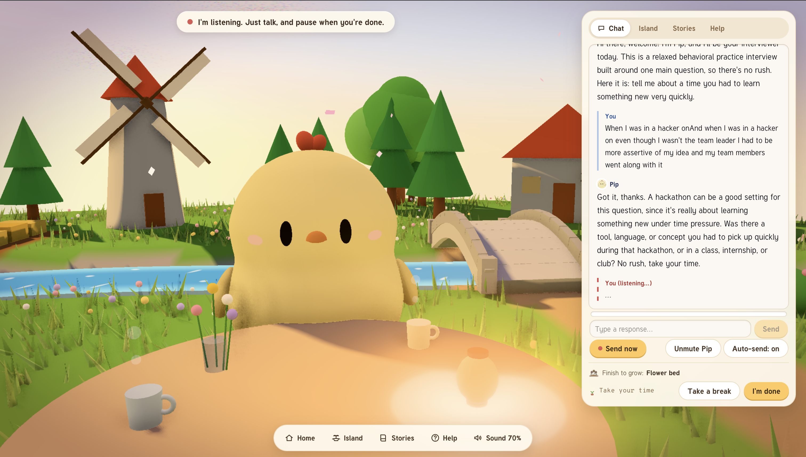
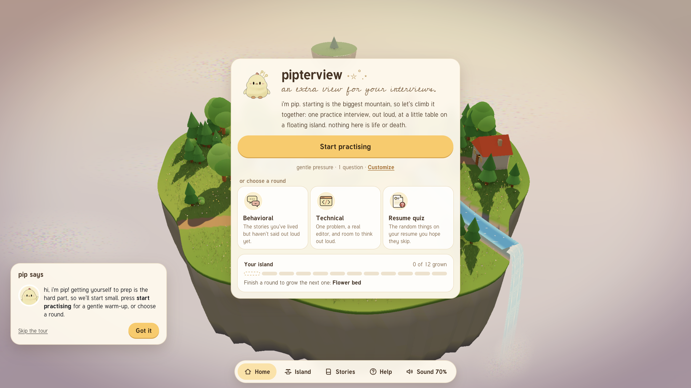
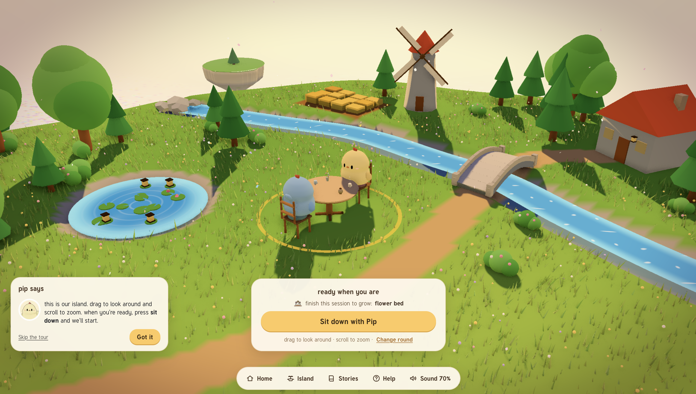

# pipterview ⋆⭒˚.⋆

**an extra view for your interviews.**

▶ **[Watch the demo video](https://www.youtube.com/watch?v=_IsdBJio0c0)**



## What is it?

A 3D world to help tech students overcome interview anxiety.



## Why

As students in tech, we know getting chosen for an interview is like finding the pot of gold at the end of the rainbow.

But what happens when we're too lost, overwhelmed and anxious to know how to prepare?

Seeking help is hard, and starting is often the biggest mountain.

That's why we made **pipterview**: another set of eyes, ears and advice for the words you can't quite get out, the code you don't know how to write, the skills you can't explain.

To make interview prep less scary, and ultimately an everyday part of your life. Consistency over catastrophe.

## How it works

Add context about yourself, like your resume or target roles, and choose which type of interview (behavioral, technical, resume skills quiz) you want to practice.

Talk through it with Pip, building skills and seeing a summary of your performance after each session. Keep going to grow plants on your island garden.



Technical mocks happen in our own code editor, built on **Monaco Editor**, with Python running in the browser through **Pyodide** (the real Python interpreter compiled to WebAssembly). It includes a **test-harness generator** for Java, C++ and C, a grading layer, and **exact or any-order comparison** for questions with multiple correct answers.

## Made with

- Next.js 16, React 19, TypeScript
- Three.js + React Three Fiber
- Tailwind CSS
- Claude via the Anthropic SDK
- ElevenLabs

## Run it locally

```bash
npm install
cp .env.example .env.local   # add ANTHROPIC_API_KEY, or set MOCK_AI=1 to run without one
npm run dev
```

Open http://localhost:3000 in Chrome or Edge (voice input needs the Web Speech API).

| Variable | |
|---|---|
| `ANTHROPIC_API_KEY` | Claude API key |
| `ELEVENLABS_API_KEY` | Optional, for Pip's voice (falls back to the browser voice) |
| `MOCK_AI=1` | Scripted interviewer, no key needed |

## Known limitations

- Everything is stored **locally** for ease of access, so you reset your progress in a new browser.
- Talking to the interviewer is still finicky, especially in a **back-and-forth conversation**. Sometimes we'd get cut off or talked over, not ideal when you're prepping for interviews.
- C, C++ and Java are turned off in the deployed app for safety: they run on a server, and **running other people's code needs a proper sandbox**. Until we add one, only Python, JavaScript and TypeScript run in the deployed app, straight in the browser.
- **API limits:** public users are rate-limited, so anyone can use the app, but not indefinitely.

## What's next

- **System design interviews** as one of the selectable rounds.
- More customization, and more testing with real students: which interviews are hardest to prepare for, honest critique of the game-like idea, and whether it actually reduces friction-induced anxiety.
- **Community features,** so students can mock interview each other inside the 3D world.

---

thanks for checking out pipterview ٩(^ᗜ^ )و ´- until next time...
